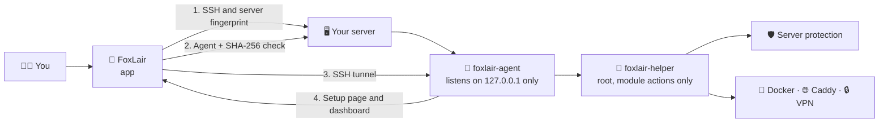

 

**Enter your server details — FoxLair turns it into a secured personal cloud.**

The app connects over SSH, installs an agent and then walks you through setup:
protection, Docker, VPN, dashboard. Modules are added with one click. It runs on Windows, Android and Linux
and looks like the rest of the DiFoxen family — in the Fox Brand design.

 

[**What it is**](#-what-it-is) ·
[**Fox Brand**](#-fox-brand) ·
[**Tail**](#-tail) ·
[**Tray**](#-tray) ·
[**Server page**](#-server-page) ·
[**Download**](#-download) ·
[**Security**](#-security)

---

## 🎯 What it is

You have a VPS or a home server but no desire to learn Linux administration. FoxLair does the work:

| | |
|---|---|
| 🔌 **Connects over SSH** | Checks the server fingerprint, privileges, disk, memory and storage media |
| 🦊 **Installs an agent** | A small service that runs only the app's commands and opens no ports to the internet |
| 🔑 **Forgets the password** | Afterwards it signs in with your computer's key |
| 🛡 **Protects the server** | Key-only login, firewall, fail2ban, automatic security updates — each part on its own |
| 🧩 **Installs modules** | Docker, Caddy, VPN, DNS, file storage, game servers, smart home — one click from the store |
| 📊 **Shows a dashboard** | Load, memory, disk, services and module state, no terminal needed |
| 🖥 **Gives you a console** | When you do need a command line, it is right on the server page, next to the service logs |
| 🧭 **Lives in the tray** | On desktop the window's close button hides FoxLair to the tray; launch at sign-in is on the first step |
| 📱 **Runs everywhere** | Windows, Android and Linux: install the agent and manage the server from your desk or on the move |

A fox guide named **Tail** explains every step: what will happen, why it helps and what the risk is.
Nothing changes without your confirmation.

## 🎨 Fox Brand

Since 0.3.0 FoxLair looks like every DiFoxen app: the shared fox mark, font, buttons, dialogs and motion.
The three old styles are replaced by **three brand palettes**, each with a **light, dark or system theme**.
You choose on the first step, and the choice carries over to the server page.

<table>
<tr>
<td width="33%"></td>
<td width="33%"></td>
<td width="33%"></td>
</tr>
<tr>
<td width="33%"></td>
<td width="33%"></td>
<td width="33%"></td>
</tr>
<tr>
<td align="center"><b>Toffee</b> warm caramel, the default</td>
<td align="center"><b>Cocoa</b> deep chocolate</td>
<td align="center"><b>Forest</b> forest green</td>
</tr>
</table>

| Setting | Options |
|---|---|
| 🎨 Palette | Toffee · Cocoa · Forest |
| 🌗 Theme | System · Light · Dark |
| ✨ Motion | System · Full · Reduced — reduced removes movement, colors still change smoothly |
| 🌐 Language | Русский · English |

<table>
<tr>
<td width="65%"></td>
<td width="35%"></td>
</tr>
<tr>
<td align="center">First launch: language, appearance and what closing the window does</td>
<td align="center">The same choice on the phone</td>
</tr>
</table>

### On the phone

The interface is laid out separately for desktop, tablet and phone: on the phone sections sit at the bottom
and dialogs become bottom sheets.

<table>
<tr>
<td width="33%"></td>
<td width="33%"></td>
<td width="33%"></td>
</tr>
<tr>
<td align="center">Toffee · light</td>
<td align="center">Cocoa · dark</td>
<td align="center">Forest · dark</td>
</tr>
</table>

## 🦊 Tail

Tail is the Fox Brand mascot and your guide. He greets you right after the agent is installed, then sits in the corner
of the wizard and explains what each step does. He speaks politely, is honest about risks, and his speech bubble
never covers the buttons. Hints can be turned off in settings at any time.

<table>
<tr>
<td width="50%"></td>
<td width="50%"></td>
</tr>
<tr>
<td align="center">Greeting after the agent is installed</td>
<td align="center">A hint in the corner of the wizard</td>
</tr>
</table>

## 🧭 Tray

On desktop FoxLair lives in the tray: Open FoxLair, Settings…, Check for updates… and Quit FoxLair.
On Windows a right click opens the Fox Brand panel in your palette; on Linux it is a system menu with the same items.
Closing the window hides to the tray by default; launch at sign-in and start minimized are on the first wizard step.

<table>
<tr>
<td width="33%" align="center"></td>
<td width="33%" align="center"></td>
<td width="33%" align="center"></td>
</tr>
<tr>
<td align="center">Forest · dark · English</td>
<td align="center">Toffee · light · Русский</td>
<td align="center">Cocoa · dark · Русский</td>
</tr>
</table>

## 🖥 Server page

Dashboard, modules, settings, console and service logs — all on one page served by the agent on your server.

<table>
<tr>
<td width="50%"></td>
<td width="50%"></td>
</tr>
<tr>
<td align="center">Settings: language, Tail, appearance, security</td>
<td align="center">Console and service logs — a dark island in any theme</td>
</tr>
</table>

## ⚙️ How it works

- **Nothing is exposed.** The agent listens on the server itself; the app reaches it through an SSH tunnel.
- **The password is needed once.** After that the app signs in with your computer's key, kept in the system credential store.
- **Only the helper changes the system**, and only with actions described in the modules. The one exception is the
  server console — you asked for it, and it does exactly what your own SSH session does.
- **The agent comes from the website**, not inside the installer: a signed manifest, SHA-256 and signature checks —
  by the app and by the agent itself.
- **Setup survives a reboot.** Every step is journaled: an unfinished one is repeated, a finished one is skipped.

## 📥 Download

The latest version is on the [Releases](https://github.com/DiFoxenGit/foxlair/releases/latest) page and at
[foxlair.ru](https://foxlair.ru). Files of version 0.3.1:

| Platform | File | Use it for |
|---|---|---|
| 🪟 Windows | [`FoxLair-0.3.1-windows-x64-setup.exe`](https://github.com/DiFoxenGit/foxlair/releases/download/v0.3.1/FoxLair-0.3.1-windows-x64-setup.exe) | The installer — for most people |
| 🪟 Windows | [`FoxLair-0.3.1-windows-x64.msi`](https://github.com/DiFoxenGit/foxlair/releases/download/v0.3.1/FoxLair-0.3.1-windows-x64.msi) | Companies and group policies |
| 🤖 Android | [`FoxLair-0.3.1-android.apk`](https://github.com/DiFoxenGit/foxlair/releases/download/v0.3.1/FoxLair-0.3.1-android.apk) | arm64 — almost every phone |
| 🤖 Android | [`FoxLair-0.3.1-android-universal.apk`](https://github.com/DiFoxenGit/foxlair/releases/download/v0.3.1/FoxLair-0.3.1-android-universal.apk) | All architectures, a bigger file |
| 🐧 Linux | [`FoxLair-0.3.1-linux-amd64.deb`](https://github.com/DiFoxenGit/foxlair/releases/download/v0.3.1/FoxLair-0.3.1-linux-amd64.deb) | Debian, Ubuntu |
| 🐧 Linux | [`FoxLair-0.3.1-linux-x86_64.rpm`](https://github.com/DiFoxenGit/foxlair/releases/download/v0.3.1/FoxLair-0.3.1-linux-x86_64.rpm) | Fedora, openSUSE |
| 🐧 Linux | [`FoxLair-0.3.1-linux-x86_64.AppImage`](https://github.com/DiFoxenGit/foxlair/releases/download/v0.3.1/FoxLair-0.3.1-linux-x86_64.AppImage) | Other distributions, no install |

Checksums are in [`SHA256SUMS`](https://github.com/DiFoxenGit/foxlair/releases/download/v0.3.1/SHA256SUMS):
`sha256sum -c SHA256SUMS --ignore-missing`.

### Install

1. Download the file for your system from the table above.
2. Run it and pick language, palette and theme.
3. Enter the server address, user and password from your hosting provider.
4. Confirm the server fingerprint and wait for the agent — everything else happens on the server page.

**Server requirements:** Ubuntu 22.04 or 24.04 LTS, x86_64 or ARM64, 512 MB RAM and 2 GB free space.
The internet during installation is needed by your device, not by the server: the app downloads the agent
and sends it over SSH.

**Updates.** On Windows and Android, app 0.2.25 and newer offers to update itself. On Linux, install the new
package. The server agent updates itself — the server page offers it.

<b>Linux: system requirements</b>

 

- glibc 2.34 or newer and WebKitGTK 4.1.
- Install `.deb` and `.rpm` with `apt` or `dnf` — dependencies come along.
- Make the `.AppImage` executable: `chmod +x FoxLair-0.3.1-linux-x86_64.AppImage`.
- The app does not update itself on Linux: install the new package over the old one.
- The tray is a system menu with the same items as the Windows panel.

> [!NOTE]
> The app is not signed with a certificate authority yet, so Windows shows a SmartScreen warning:
> "More info" → "Run anyway". The APKs are signed with the release key (v2 and v3 schemes) and install over
> earlier versions. Agent updates are signed with the project key and verified before install.

## 🛡 Security

- The server key fingerprint is shown on first connection and checked on every one after.
- The server password is never stored: it is only needed to install the agent.
- Your computer's key and access tokens live in the operating system credential store.
- The agent API requires a token, listens on loopback only and checks the `Host` header.
- Agent updates are downloaded over HTTPS and verified by SHA-256 and an Ed25519 signature.
- The server page opens with a one-time code that lives 30 seconds and burns on first use.
- Every computer of yours has its own token: coming back from another one with the server password
  does not take access away from the rest.
- The system is changed only by the privileged helper and only by actions described in the modules.
  The one exception is the server console — you asked for it, and it does exactly what your own SSH session does.

Found a vulnerability? Use a [private report](https://github.com/DiFoxenGit/foxlair/security/advisories/new) — see [SECURITY.md](SECURITY.md).

## ❓ FAQ

<b>Where did the Graphite, Glass and Terminal styles go?</b>

 

In 0.3.0 they were replaced by the Fox Brand palettes, the shared look of all DiFoxen apps. Your old style moves
over by itself: it becomes the Toffee palette, and your theme and language stay. You can pick another palette in
settings at any time.

<b>Is the source code here?</b>

 

No, this is a showcase: the repository is for releases, discussions and bug reports.
The code is closed, but everything the agent does to your server is shown in the change plan before it is applied.

## 💬 Feedback

Bugs and ideas — in [Issues](https://github.com/DiFoxenGit/foxlair/issues). Russian or English is fine.

## 📄 License

Proprietary software, all rights reserved — see [LICENSE](LICENSE).

 © 2026 DiFoxen · FoxLair · <a href="README.md">Русский</a>

