

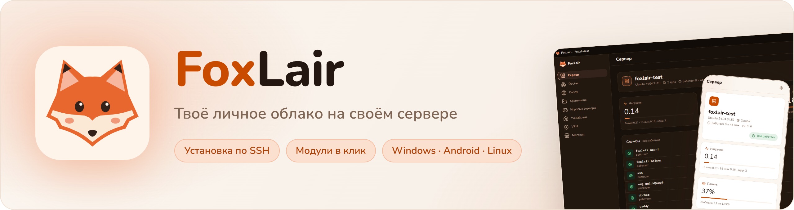

 

**Вводите данные сервера — FoxLair превращает его в защищённое личное облако.**

Приложение подключается по SSH, ставит агента и дальше ведёт настройку в понятном мастере:
защита, Docker, VPN, дашборд. Модули добавляются одним нажатием. Работает на Windows, Android и Linux
и выглядит как всё семейство приложений DiFoxen — в оформлении Fox Brand.

 

[**Что это**](#-что-это) ·
[**Fox Brand**](#-fox-brand) ·
[**Тейл**](#-тейл) ·
[**Трей**](#-трей) ·
[**Страница сервера**](#-страница-сервера) ·
[**Скачать**](#-скачать) ·
[**Безопасность**](#-безопасность)

---

## 🎯 Что это

У вас есть VPS или домашний сервер, но нет желания разбираться в Linux. FoxLair делает всю работу за вас:

| | |
|---|---|
| 🔌 **Подключается по SSH** | Проверяет отпечаток сервера, права, место, память, носитель системы |
| 🦊 **Ставит агента** | Небольшую службу, которая выполняет только команды приложения и не открывает портов наружу |
| 🔑 **Забывает пароль** | После установки заходит по ключу вашего компьютера — пароль сервера больше не нужен |
| 🛡 **Защищает сервер** | Вход по ключу, фаервол, fail2ban, автообновления — каждая часть по отдельности |
| 🧩 **Ставит модули** | Docker, Caddy, VPN, DNS, хранилище файлов, игровые серверы, умный дом — одним нажатием |
| 📊 **Показывает дашборд** | Нагрузка, память, диск, службы и состояние модулей — без терминала |
| 🖥 **Даёт консоль** | Когда всё же нужна командная строка, она есть прямо на странице сервера — вместе с журналами служб |
| 🧭 **Живёт в трее** | На компьютере крестик окна сворачивает FoxLair в трей, а запуск при входе в систему включается на первом шаге |
| 📱 **Работает везде** | Windows, Android и Linux: поставить агента и управлять сервером с компьютера или из дороги |

Каждый шаг объясняет лис-проводник **Тейл**: что произойдёт, чем это полезно и чем рискованно.
Ничего не меняется без вашего подтверждения.

## 🎨 Fox Brand

С версии 0.3.0 FoxLair выглядит как все приложения DiFoxen: общий знак-лис, шрифт, кнопки, окна и анимации.
Вместо прежних трёх стилей — **три палитры** бренда, и в каждой **светлая, тёмная или системная тема**.
Выбор делается на первом шаге и переносится на страницу сервера.

<table>
<tr>
<td width="33%">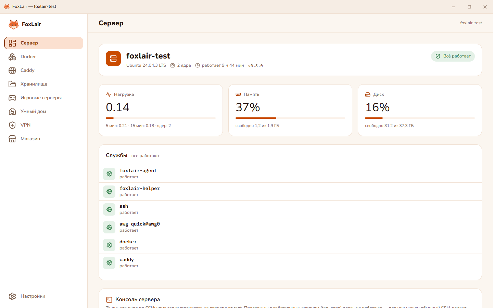</td>
<td width="33%">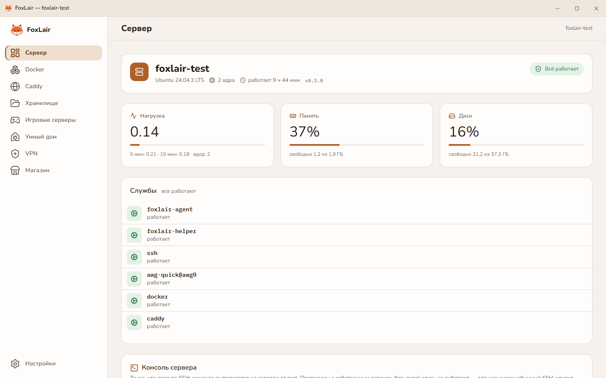</td>
<td width="33%">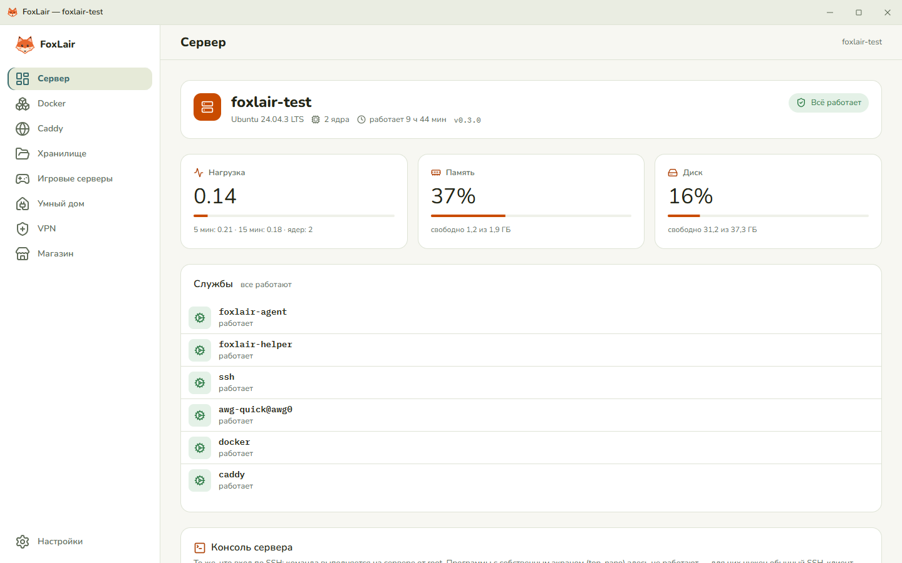</td>
</tr>
<tr>
<td width="33%">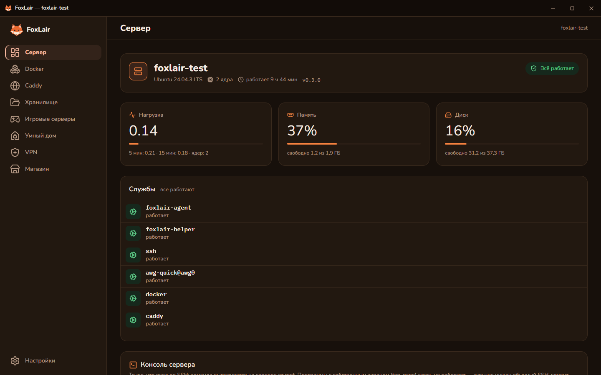</td>
<td width="33%"></td>
<td width="33%">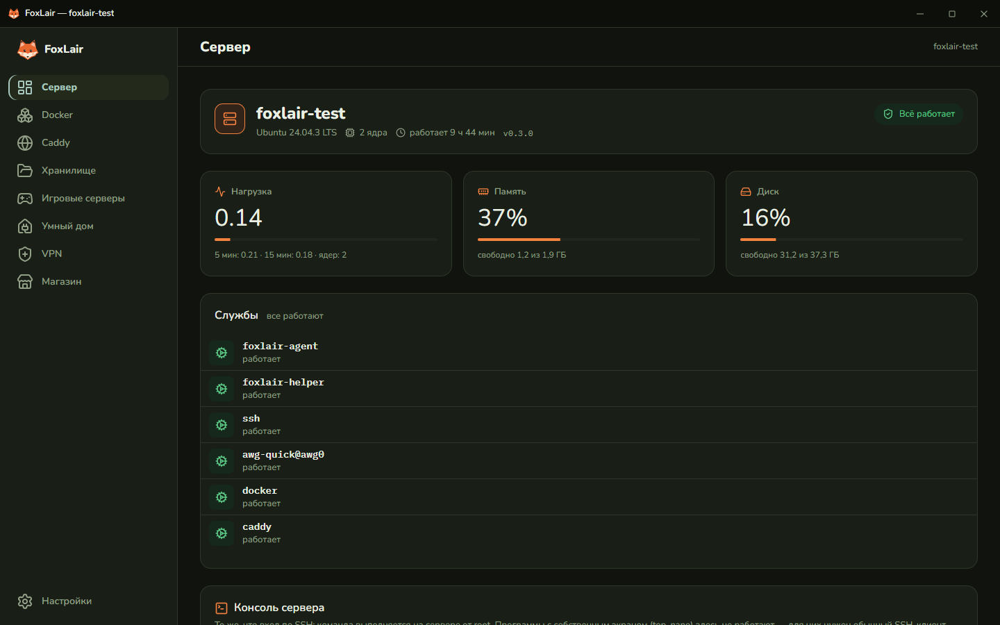</td>
</tr>
<tr>
<td align="center"><b>Toffee</b> тёплая карамель, по умолчанию</td>
<td align="center"><b>Cocoa</b> глубокий шоколад</td>
<td align="center"><b>Forest</b> лесная зелень</td>
</tr>
</table>

| Настройка | Варианты |
|---|---|
| 🎨 Палитра | Toffee · Cocoa · Forest |
| 🌗 Тема | Системная · Светлая · Тёмная |
| ✨ Движение | Системное · Полное · Меньше — «Меньше» убирает сдвиги, цвет по-прежнему меняется плавно |
| 🌐 Язык | Русский · English |

<table>
<tr>
<td width="65%">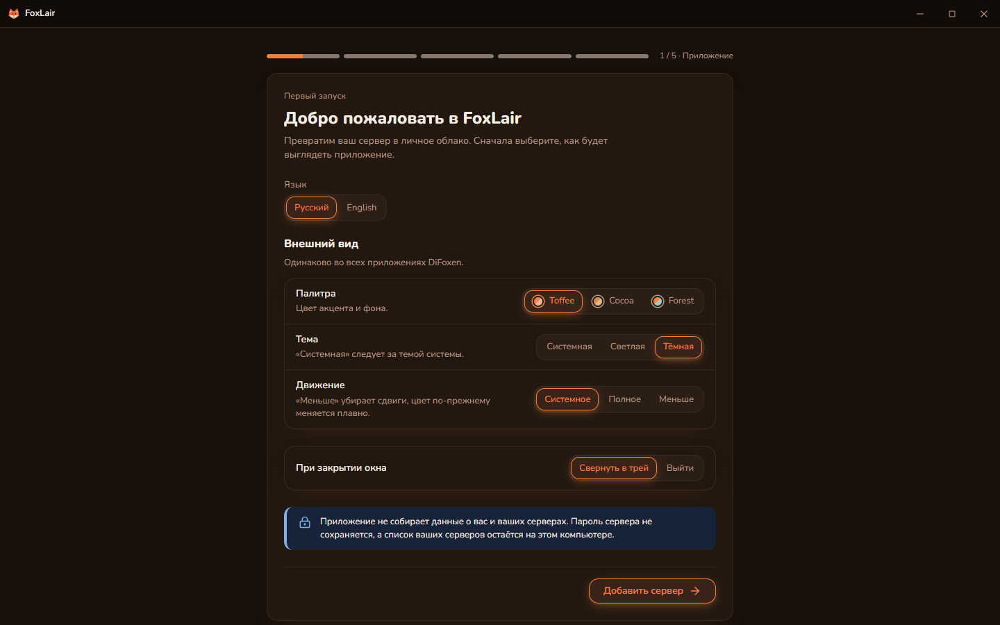</td>
<td width="35%">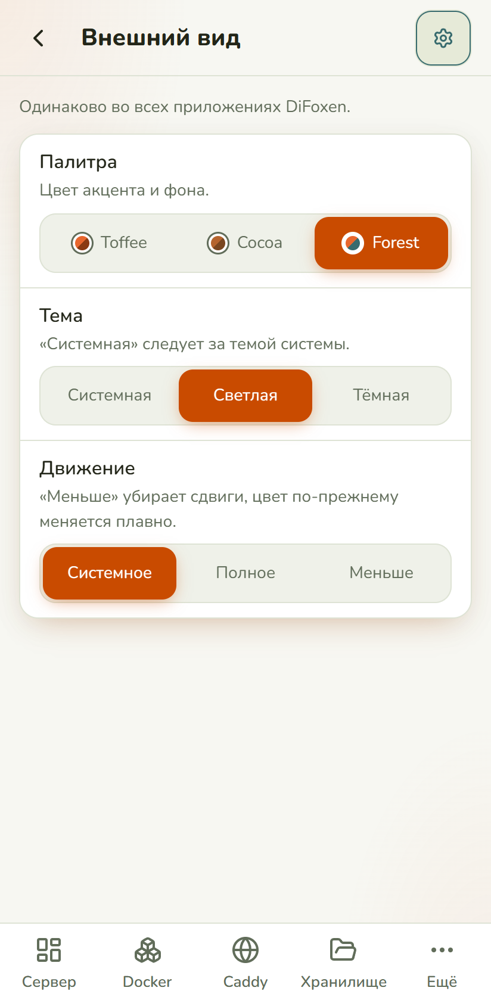</td>
</tr>
<tr>
<td align="center">Первый запуск: язык, внешний вид и что делать при закрытии окна</td>
<td align="center">Тот же выбор на телефоне</td>
</tr>
</table>

### На телефоне

Интерфейс собран отдельно для компьютера, планшета и телефона: на телефоне разделы — внизу, окна — шторками.

<table>
<tr>
<td width="33%">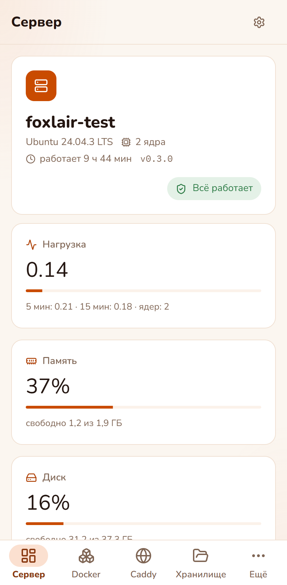</td>
<td width="33%">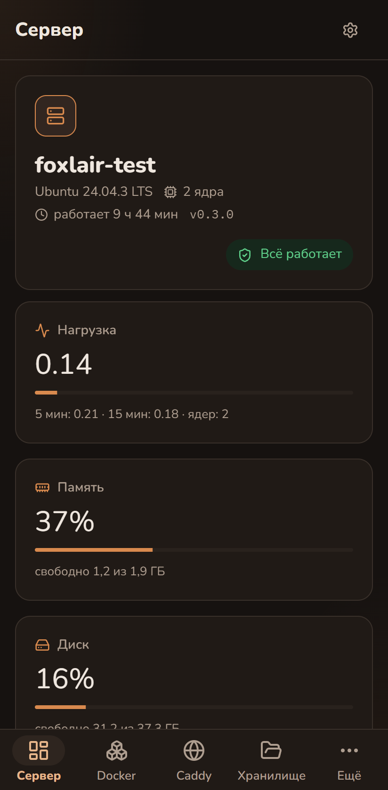</td>
<td width="33%">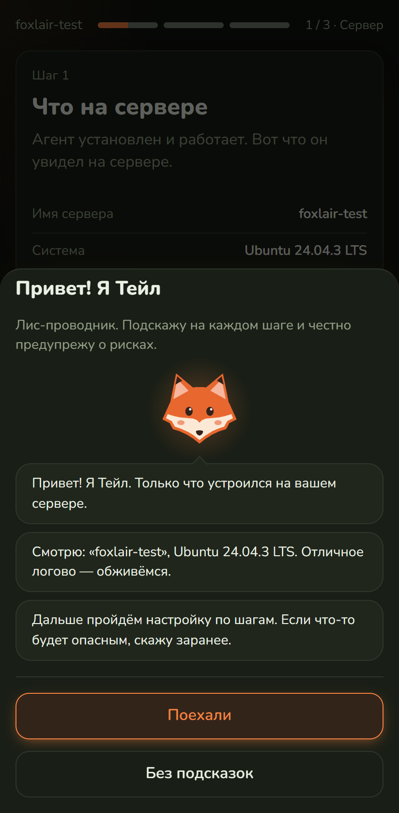</td>
</tr>
<tr>
<td align="center">Toffee · светлая</td>
<td align="center">Cocoa · тёмная</td>
<td align="center">Forest · тёмная</td>
</tr>
</table>

## 🦊 Тейл

Тейл — маскот Fox Brand и ваш проводник. Он встречает сразу после установки агента, а дальше сидит в углу мастера
и подсказывает, что делает каждый шаг. Обращается к вам на «вы», честно предупреждает о рисках, а реплика
встаёт так, чтобы не закрывать кнопки. Подсказки выключаются в настройках в любой момент.

<table>
<tr>
<td width="50%">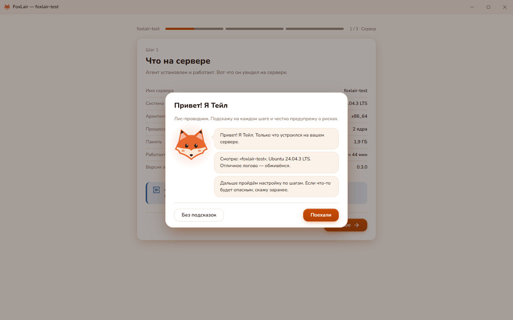</td>
<td width="50%">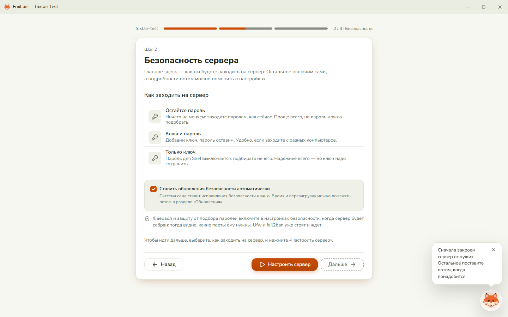</td>
</tr>
<tr>
<td align="center">Приветствие после установки агента</td>
<td align="center">Подсказка в углу мастера</td>
</tr>
</table>

## 🧭 Трей

На компьютере FoxLair живёт в трее: «Открыть FoxLair», «Настройки…», «Проверить обновления…» и «Выйти из FoxLair».
На Windows по правому щелчку открывается панель Fox Brand в цветах выбранной палитры, на Linux — системное меню
того же состава. Крестик окна по умолчанию сворачивает в трей; «Запускать при входе в систему» и
«Запускать свёрнутым в трей» — на первом шаге мастера.

<table>
<tr>
<td width="33%" align="center">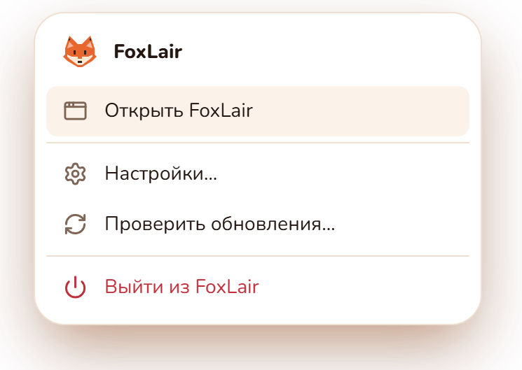</td>
<td width="33%" align="center">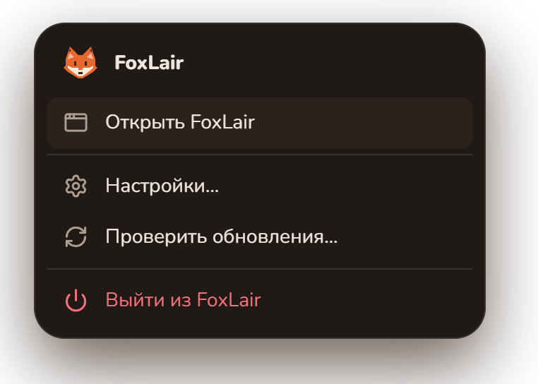</td>
<td width="33%" align="center">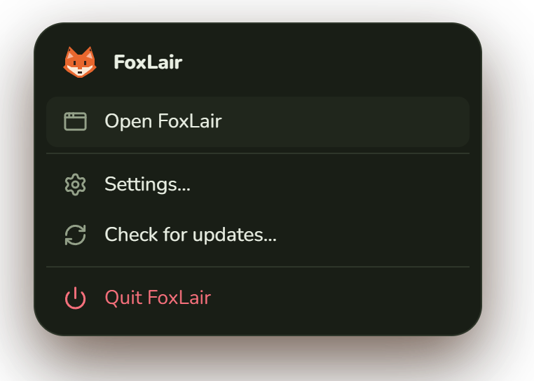</td>
</tr>
<tr>
<td align="center">Toffee · светлая</td>
<td align="center">Cocoa · тёмная</td>
<td align="center">Forest · тёмная · English</td>
</tr>
</table>

## 🖥 Страница сервера

Дашборд, модули, настройки, консоль и журналы служб — всё на одной странице, которую отдаёт агент на вашем сервере.

<table>
<tr>
<td width="50%">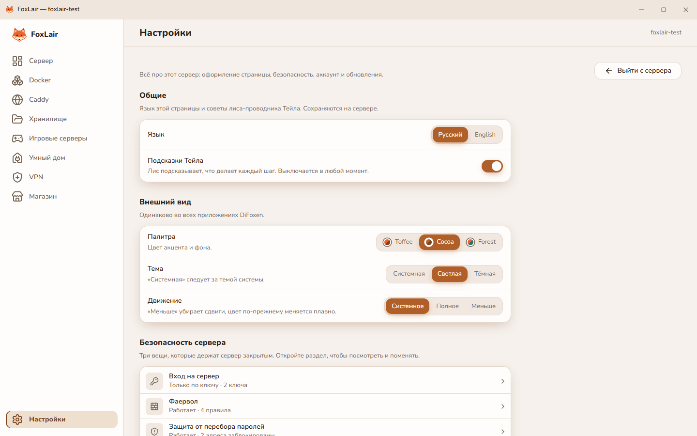</td>
<td width="50%">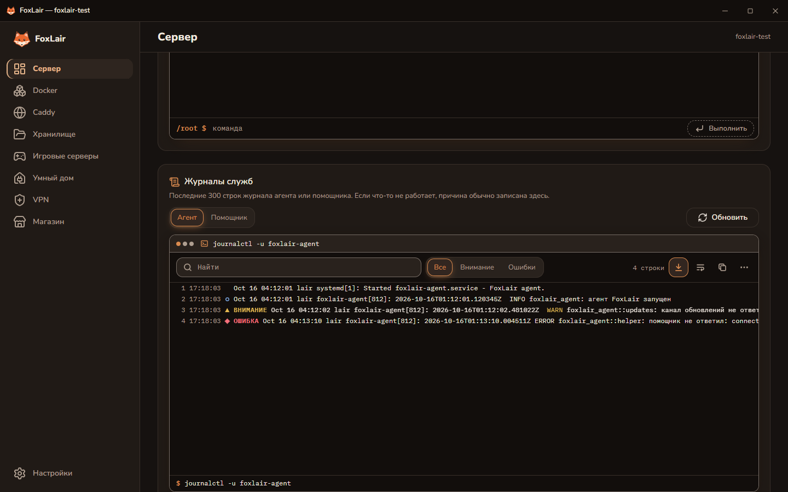</td>
</tr>
<tr>
<td align="center">Настройки: язык, Тейл, внешний вид, безопасность</td>
<td align="center">Консоль и журналы служб — тёмный остров в любой теме</td>
</tr>
</table>

## ⚙️ Как устроено

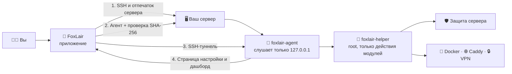

- **Наружу ничего не открывается.** Агент слушает только сам сервер, приложение приходит по SSH-туннелю.
- **Пароль нужен один раз.** Дальше вход по ключу вашего компьютера, который хранится в хранилище паролей системы.
- **Систему меняет только помощник** и только теми действиями, что описаны в модулях. Единственное
  исключение — консоль сервера: вы сами её просили, и она делает ровно то же, что ваш вход по SSH.
- **Агент приезжает с сайта**, а не лежит внутри установщика: подписанный манифест, сверка SHA-256
  и подписи — и приложением, и самим агентом.
- **Настройка переживает перезагрузку.** Каждый шаг пишется в журнал: незавершённый повторится, выполненный — пропустится.

## 📥 Скачать

Последняя версия — на странице [релизов](https://github.com/DiFoxenGit/foxlair/releases/latest) и на [foxlair.ru](https://foxlair.ru).
Файлы версии 0.3.1:

| Платформа | Файл | Для чего |
|---|---|---|
| 🪟 Windows | [`FoxLair-0.3.1-windows-x64-setup.exe`](https://github.com/DiFoxenGit/foxlair/releases/download/v0.3.1/FoxLair-0.3.1-windows-x64-setup.exe) | Установщик — для большинства |
| 🪟 Windows | [`FoxLair-0.3.1-windows-x64.msi`](https://github.com/DiFoxenGit/foxlair/releases/download/v0.3.1/FoxLair-0.3.1-windows-x64.msi) | Для компаний и групповых политик |
| 🤖 Android | [`FoxLair-0.3.1-android.apk`](https://github.com/DiFoxenGit/foxlair/releases/download/v0.3.1/FoxLair-0.3.1-android.apk) | arm64 — почти все телефоны |
| 🤖 Android | [`FoxLair-0.3.1-android-universal.apk`](https://github.com/DiFoxenGit/foxlair/releases/download/v0.3.1/FoxLair-0.3.1-android-universal.apk) | Все архитектуры, файл крупнее |
| 🐧 Linux | [`FoxLair-0.3.1-linux-amd64.deb`](https://github.com/DiFoxenGit/foxlair/releases/download/v0.3.1/FoxLair-0.3.1-linux-amd64.deb) | Debian, Ubuntu |
| 🐧 Linux | [`FoxLair-0.3.1-linux-x86_64.rpm`](https://github.com/DiFoxenGit/foxlair/releases/download/v0.3.1/FoxLair-0.3.1-linux-x86_64.rpm) | Fedora, openSUSE |
| 🐧 Linux | [`FoxLair-0.3.1-linux-x86_64.AppImage`](https://github.com/DiFoxenGit/foxlair/releases/download/v0.3.1/FoxLair-0.3.1-linux-x86_64.AppImage) | Другие дистрибутивы, без установки |

Суммы файлов — в [`SHA256SUMS`](https://github.com/DiFoxenGit/foxlair/releases/download/v0.3.1/SHA256SUMS):
`sha256sum -c SHA256SUMS --ignore-missing`.

### Установка

1. Скачайте файл для своей системы из таблицы выше.
2. Запустите и выберите язык, палитру и тему.
3. Введите адрес сервера, логин и пароль, которые прислал хостинг.
4. Подтвердите отпечаток сервера и дождитесь установки агента — дальше всё происходит на странице сервера.

**Что нужно от сервера:** Ubuntu 22.04 или 24.04 LTS, x86_64 или ARM64, от 512 МБ памяти и 2 ГБ свободного места.
Интернет во время установки нужен вашему устройству, а не серверу: агента скачивает приложение и передаёт по SSH.
Подойдёт любой VPS, домашний компьютер или Raspberry Pi (лучше не с SD-карты — приложение предупредит).

**Обновления.** На Windows и Android приложение 0.2.25 и новее предлагает обновиться само. На Linux новую версию
ставят пакетом. Агент на сервере обновляется сам — страница сервера предложит обновиться.

<b>Linux: что нужно системе</b>

 

- glibc 2.34 или новее и WebKitGTK 4.1.
- `.deb` и `.rpm` ставьте через `apt` или `dnf` — зависимости подтянутся сами.
- `.AppImage` достаточно сделать исполняемым: `chmod +x FoxLair-0.3.1-linux-x86_64.AppImage`.
- Приложение на Linux не обновляется само: новую версию ставят пакетом поверх.
- Трей — системное меню с теми же пунктами, что панель на Windows.

> [!NOTE]
> Приложение пока не подписано сертификатом удостоверяющего центра, поэтому Windows покажет предупреждение SmartScreen:
> «Подробнее» → «Выполнить в любом случае». APK подписаны ключом выпуска (схемы v2 и v3) и ставятся поверх прежних версий.
> Обновления агента подписаны ключом проекта и проверяются перед установкой.

## 🛡 Безопасность

- Отпечаток ключа сервера показывается при первом подключении и сверяется при каждом следующем.
- Пароль сервера не сохраняется: он нужен только для установки агента.
- Ключ вашего компьютера и токены доступа лежат в хранилище паролей операционной системы, а не в файлах приложения.
- API агента закрыт токеном, доступен только с самого сервера и проверяет заголовок `Host` — страница из интернета до него не достучится.
- Страница сервера открывается по одноразовому коду, который живёт полминуты и сгорает при первом входе.
- У каждого вашего компьютера свой токен: вернуться с другого по паролю сервера можно, не отбирая доступ у прежних.
- Обновления агента скачиваются по HTTPS, сверяются по SHA-256 и подписи Ed25519; ставит их привилегированная служба, а не сам агент.
- Шаг «Вход только по ключу» не отключит пароль, пока не убедится, что вход по ключу работает.
- Защита собирается по частям: по каждой — вход, фаервол, fail2ban, обновления — вы решаете сами,
  и отказ от части не просто пропускает её, а возвращает сервер к тому, что было до неё.

Нашли уязвимость? Напишите через [приватный отчёт GitHub](https://github.com/DiFoxenGit/foxlair/security/advisories/new) — см. [SECURITY.md](SECURITY.md).

## 🗺 Дорожная карта

- [x] Установка агента по SSH и защищённый туннель
- [x] Вход без пароля: ключ устройства и токен агента
- [x] Модули: защита сервера, Docker, Caddy
- [x] Дашборд сервера и обновления агента с проверкой подписи
- [x] Магазин модулей: каталог приходит с сервера проекта, пакеты подписаны
- [x] VPN на AmneziaWG: устройства с QR-кодом, маршруты и маскировка
- [x] DNS с блокировкой рекламы
- [x] Хранилище файлов и игровые серверы
- [x] Умный дом
- [x] Приложение для Android
- [x] Консоль сервера и журналы служб на странице сервера
- [x] Оформление Fox Brand: три палитры, светлая и тёмная темы, Тейл, трей
- [x] Приложение для Linux
- [ ] Фото и кино
- [ ] macOS

## ❓ Частые вопросы

<b>Куда делись стили «Графит», «Стекло» и «Терминал»?</b>

 

В 0.3.0 их заменили палитры Fox Brand — общего оформления всех приложений DiFoxen. Прежний стиль переносится
сам: он становится палитрой Toffee, а тема и язык остаются прежними. Другую палитру можно выбрать в настройках
в любой момент.

<b>Что будет с тем, что уже стоит на сервере?</b>

 

Перед установкой FoxLair читает сервер и показывает, что нашёл. Перед каждым изменением показывает план
и ждёт подтверждения. Модуль «Caddy» откажется работать, если порты 80 и 443 занял чужой веб-сервер,
а не станет его перенастраивать.

<b>Нужно ли уметь работать в терминале?</b>

 

Нет. Нужны только адрес сервера, логин и пароль из письма хостинга. Всё остальное делает приложение
и объясняет простыми словами.

<b>Что если я потеряю компьютер с ключом?</b>

 

Сервер останется вашим. При установке вы задаёте пароль сервера — им и возвращают доступ с нового
компьютера: приложение обменяет его на новый доступ, ничего не переустанавливая. На сервере этот пароль
хранится только в виде хеша, а подобрать его мешает пауза, которая удлиняется после каждой ошибки.

<b>Здесь есть исходный код?</b>

 

Нет, это витрина: репозиторий нужен для релизов, обсуждений и сообщений об ошибках.
Код закрыт, но всё, что агент делает с сервером, видно в плане изменений перед применением.

## 💬 Обратная связь

Ошибки и идеи — во [вкладке Issues](https://github.com/DiFoxenGit/foxlair/issues). Пишите по-русски или по-английски.

## 📄 Лицензия

Проприетарное ПО, все права защищены — см. [LICENSE](LICENSE).

 © 2026 DiFoxen · FoxLair — ваше личное облако · <a href="README.en.md">English</a>

